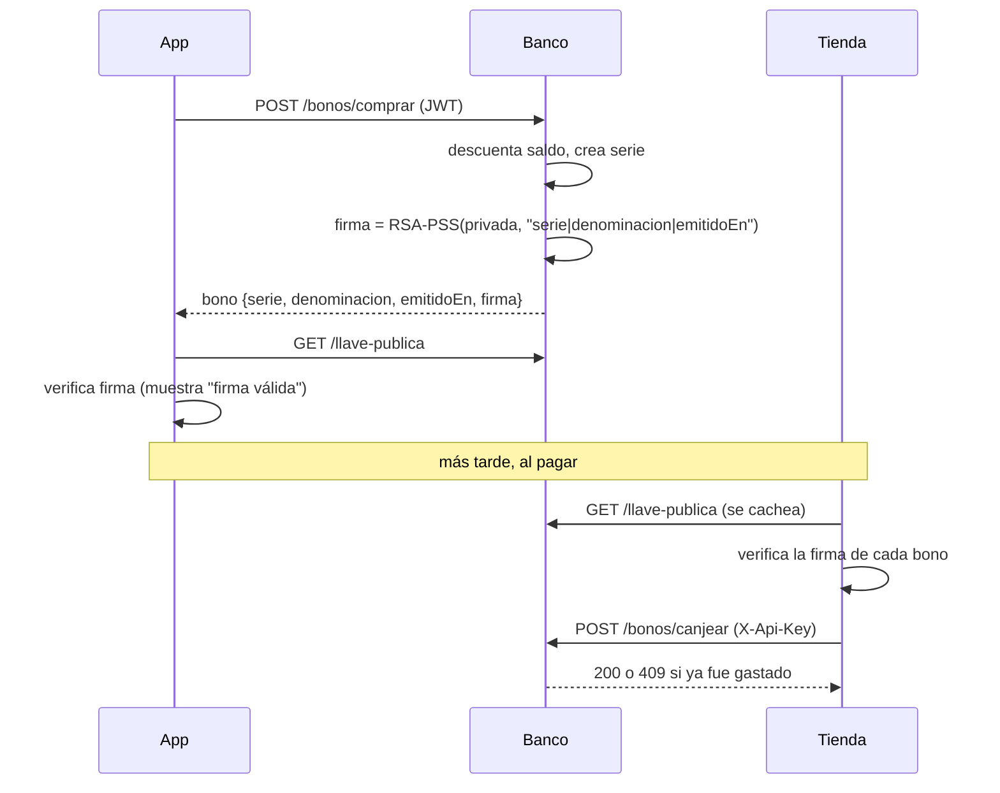
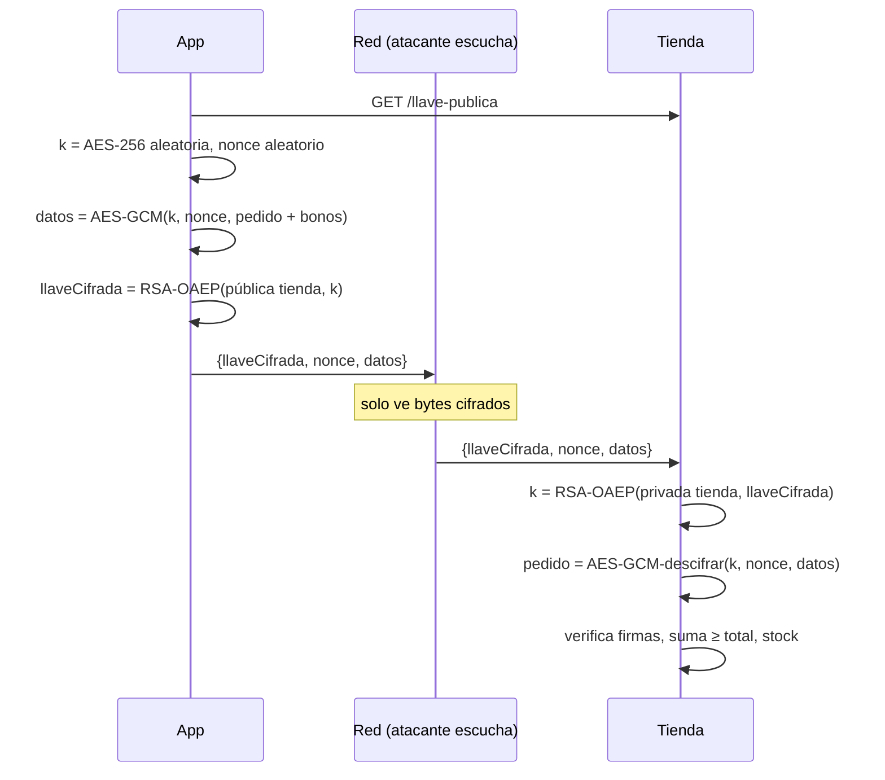

# Seguridad — análisis, propuesta e implementación

El sistema mueve dinero digital entre tres partes: la **app** del usuario, el **Banco** que emite bonos y la
**Tienda** que los acepta. Usamos los tres recursos vistos en clase: **criptografía simétrica**,
**criptografía asimétrica** y **firma digital**.

## 1. Activos que protegemos

| Activo | Por qué importa |
|---|---|
| Bonos | Son dinero. Si alguien los copia, altera o falsifica, gasta dinero que no tiene. |
| Pago en tránsito | El paquete de pago lleva bonos válidos. Si alguien lo lee en la red, puede robarlos. |
| Wallet en el celular | Guarda los bonos del usuario. Si alguien roba el teléfono, puede leerlos. |
| BD del banco | Contiene contraseñas y la CLABE de cada usuario. |
| Sesión del usuario | Quien tenga la sesión puede comprar bonos con el saldo. |

## 2. Amenazas y técnica elegida

| Amenaza | Técnica | Tipo | Dónde está |
|---|---|---|---|
| Falsificar un bono o alterarlo (cambiar $20 por $500) | Firma RSA-PSS + SHA-256 del banco | Firma digital | `Banco.Api/Services/FirmaBonos.cs` firma; `Tienda.Api/Services/BancoCliente.cs` y la app verifican |
| Espiar el pago en la red | Esquema híbrido: AES-256-GCM para los datos + RSA-OAEP-SHA256 para la llave AES | Simétrica + asimétrica | App cifra; `Tienda.Api/Services/DescifradoHibrido.cs` descifra |
| Robo del celular | Wallet cifrado con AES-256-GCM, llave derivada del PIN con PBKDF2 | Simétrica | App (Fase 7) |
| Fuga de la BD del banco | CLABE cifrada con AES-256-GCM; contraseñas con hash PBKDF2 (`PasswordHasher`) | Simétrica + hash | `Banco.Api/Services/CifradoAes.cs`, `AuthController` |
| Gastar el mismo bono dos veces | Canje transaccional: `EMITIDO → CANJEADO`, todo o nada | Control en servidor | `POST /bonos/canjear` |
| Suplantar a la tienda ante el banco | Secreto compartido `X-Api-Key`, comparado en tiempo constante | Autenticación | `BonosController.Canjear` |
| Robo o reutilización de sesión | JWT HS256 con expiración de 2 h | Firma HMAC | `AuthController` |

## 3. Firma digital de bonos

El banco tiene un par de llaves RSA 2048. Guarda la **privada** en `keys/banco-firma.pem` y publica la
**pública** en `GET /llave-publica`. Solo el banco puede firmar. Cualquiera puede verificar.

El mensaje firmado es el texto canónico `serie|denominacion|emitidoEn`, por ejemplo
`29522387-40ec-4461-9c7f-e9abde06c340|500|2026-11-03T19:53:01Z`. Si alguien cambia un solo carácter (por
ejemplo la denominación), la firma deja de verificar.

La firma no evita copiar un bono: una copia exacta también verifica. Por eso el banco lleva el registro de
canje y rechaza el segundo uso (doble gasto).

## 4. Pago cifrado híbrido

RSA solo cifra datos pequeños y es lento. AES es rápido pero necesita compartir la llave. El esquema
híbrido usa lo mejor de los dos:

1. La app descarga la llave pública de la tienda (`GET /llave-publica` de `Tienda.Api`).
2. La app genera una llave AES-256 aleatoria y un nonce de 12 bytes, nuevos en cada compra.
3. La app cifra el pedido (email, productos y bonos) con **AES-256-GCM**. GCM también agrega un tag que
   detecta cualquier alteración.
4. La app cifra la llave AES con **RSA-OAEP-SHA256** y la llave pública de la tienda.
5. La app envía `{llaveCifrada, nonce, datos}`. Solo la tienda, con su llave privada, recupera la llave AES.

Si el paquete se altera en el camino, el tag de GCM no coincide y la tienda responde 400.

## 5. Cifrado simétrico de datos guardados

- **BD del banco:** la CLABE se guarda como `base64(nonce | cifrado | tag)` con AES-256-GCM. La llave
  (`Seguridad__AesKey`) no está en la BD: viene de `.env`. Quien robe solo la BD no puede leer las CLABE.
- **Contraseñas:** no se cifran, se **hashean** con PBKDF2 (`PasswordHasher` de ASP.NET). Así nadie, ni el
  banco, puede recuperar la contraseña original.
- **Wallet en la app:** los bonos se guardan cifrados con AES-256-GCM. La llave se deriva del PIN del usuario
  con PBKDF2 y una sal aleatoria, así que la llave nunca se guarda en el celular (Fase 7 del plan).

## 6. Qué se implementó y cómo se prueba

| Control | Prueba |
|---|---|
| Firma válida verifica; bono alterado no verifica | `Tests/BonosTests.cs` |
| Doble canje → 409, y el canje es todo o nada | `Tests/BonosTests.cs` |
| Compra con paquete cifrado → 200 | `Tests/ComprasTests.cs` |
| Bono alterado → 400; bono ya gastado → 409; suma distinta → 400 | `Tests/ComprasTests.cs` |
| CLABE cifrada en BD | `psql` sobre `banco-db`: la columna `ClabeCifrada` solo tiene base64 |

Correr: `docker compose up -d banco-db tienda-db` y `dotnet test`.

## 7. Propuestas fuera de alcance

Estas medidas serían necesarias en producción. No se implementan en el proyecto escolar:

- **TLS/HTTPS** con certificados en todas las conexiones. En local usamos HTTP. El pago ya va cifrado de
  extremo a extremo, pero el login y el JWT viajarían en claro.
- **HSM o bóveda de secretos** (Azure Key Vault, HashiCorp Vault) para las llaves privadas RSA y la llave AES,
  en lugar de archivos `.pem` y `.env`.
- **Rotación de llaves** con identificador de llave (`kid`) en cada bono y en cada paquete.
- **Firma del banco en la respuesta de canje** o mTLS entre tienda y banco, en lugar de una API key fija.
- **Límite de intentos** en login y en el PIN del wallet.
- **Recuperación ante fallo parcial:** si el banco canjea los bonos y la tienda no logra guardar el pedido,
  los bonos se pierden. Se resolvería con un estado intermedio (reserva → confirmación) o con reintentos
  idempotentes.
